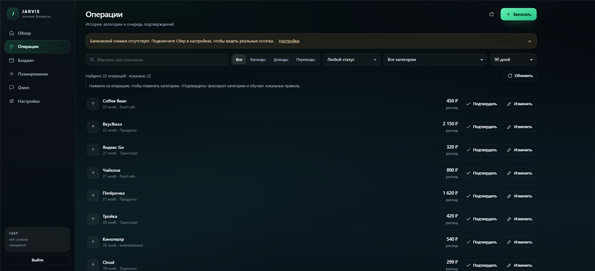
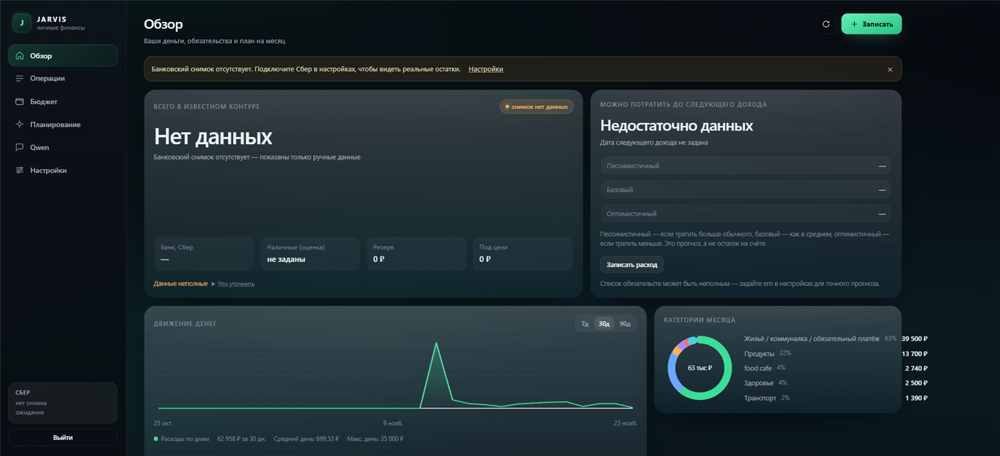
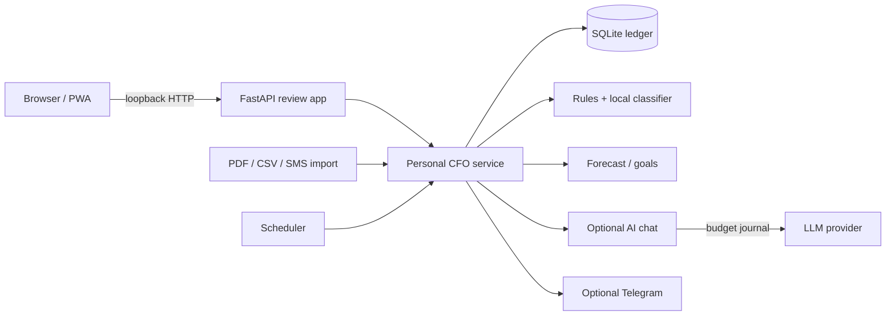

# JARVIS Finance

**A local-first, owner-only personal finance dashboard with a CFO-style review workflow.**

JARVIS Finance is a single-user web application for people who want to understand their money without handing their bank data to a SaaS. It imports statements, classifies transactions, tracks budgets and goals, builds a forward-looking cash-flow view, and keeps a human in the loop for every category decision. The web UI runs on `127.0.0.1`, stores data in SQLite, and works offline by default.



> The screenshot uses synthetic demo transactions. No real account or personal data is included.

## What it does

- **Statement ingestion** — Sber PDF statements, CSV imports, SMS parsing and manual entries. Imports are validated and staged before they touch the ledger.
- **Transaction review** — a confirmation queue with category suggestions, merchant rules and a local learning loop; every accepted decision can teach the classifier.
- **Budgets and goals** — monthly budgets, savings goals, contributions and a "can I afford this?" purchase check.
- **Cash-flow view** — income/expense timeline, category breakdown, pessimistic/base/optimistic spend scenarios and forecast readiness states.
- **Data quality and audit** — duplicate detection, source provenance, stale-snapshot labels, audit reports and verified backups.
- **Optional AI assistant** — a chat over the owner's own data with read-only finance tools, offline by default, and a governed budget journal for paid providers. Provider keys never reach the browser.
- **Owner-only access** — loopback-only server, owner key, session cookies and optional passkeys. Designed for one person, not a multi-tenant service.



## Stack

- Python 3.11–3.13, FastAPI + Uvicorn, SQLModel/SQLite
- pandas, NumPy, DuckDB, scikit-learn, CatBoost (local analytics/ML)
- Optional: sentence-transformers + Chroma (local RAG), SetFit
- pytest, ruff, mypy, Hypothesis
- Vanilla HTML/CSS/JS owner UI (no frontend build step)

## Architecture



The code is organised as a Python package under `src/jarvis`:

- `finance/` — ledger, review UI, categorisation, budgets, goals, forecast, backup, bank adapters
- `core/` — settings, SQLite engine, LLM governance layer
- `services/`, `knowledge/`, `rag/`, `invest/`, `mcp/` — assistant services, document knowledge, retrieval and read-only market/bank tool contracts

## Quick start

```bash
git clone https://github.com/Leis4/jarvis-finance.git
cd jarvis-finance
uv sync --extra dev
cp .env.example .env
uv run python -m jarvis.finance.personal_cli --no-jobs
```

Open <http://127.0.0.1:8766/>. On first start the app writes a one-time owner key to `data/cfo-review/owner-login.key`; use it on the login screen.

> The default dependency set includes PyTorch wheels for local ML. On a machine without CUDA, install a CPU build or trim the optional ML extras — the dashboard itself does not need a GPU.

Run the checks:

```bash
uv run python -m pytest tests -q
uv run ruff check src/jarvis tests
```

## Configuration

All settings use the `JARVIS_` prefix and are read from `.env`:

| Variable | Purpose | Default |
|---|---|---|
| `JARVIS_DB_PATH` | SQLite database | `data/jarvis.db` |
| `JARVIS_LLM_MODE` | `offline` / provider mode | `offline` |
| `JARVIS_LLM_API_KEY` | Optional LLM provider key | empty |
| `JARVIS_LLM_BASE_URL` | OpenAI-compatible endpoint | example endpoint |
| `JARVIS_DAILY_BUDGET_USD` / `JARVIS_MONTHLY_BUDGET_USD` | Hard AI budget | `0.10` / `3.00` |
| `JARVIS_PUBLIC_ORIGIN` | Optional tunnel origin; empty = loopback only | empty |

Bank connectivity is optional and read-only. It needs the owner's own session/PIN and is never enabled by default. No credentials are bundled.

## Status

Personal project in active development. The web app, ledger, review queue, budgets, goals, statements and backup paths are implemented and covered by tests. Some integrations (live bank session, paid AI providers, Telegram) are optional and depend on the owner's own accounts.

## Limitations

- Single-user, local-first design; not a hosted multi-tenant product.
- The Sber adapter is intentionally read-only and requires a manual login; it is not a public API client.
- AI features are optional; offline mode works without any provider key.
- The repository ships no real database, statements or credentials. Screenshots use synthetic data.

## Security and privacy

- No `.env`, owner keys, SQLite databases, statements, backups or logs are committed.
- The server binds to loopback and rejects untrusted hosts/origins.
- Provider keys stay server-side; the browser talks only to the local app.
- See [`SECURITY.md`](SECURITY.md) for the reporting policy and the data boundary.

## AI-assisted development

This project was built with heavy AI-assisted development (vibe-coding) under human direction: architecture, requirements, review and acceptance were defined by the author, while a large part of the implementation was produced with AI coding agents. The README describes only functionality present in this repository.

## License

Original code is released under the MIT License — see [`LICENSE`](LICENSE). Third-party dependencies keep their own licenses; see [`THIRD_PARTY_NOTICES.md`](THIRD_PARTY_NOTICES.md).
